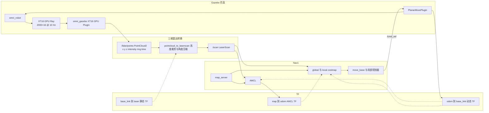

# 三维激光雷达仿真链路

当前仿真使用项目内置的 GPU Ray 插件模拟 XT16 规格的 16 线三维激光雷达，直接发布
`sensor_msgs/PointCloud2`，再压缩成 Nav1 使用的二维
`sensor_msgs/LaserScan`。

完整导航可通过一个入口启动：

```bash
source /opt/ros/noetic/setup.bash
source devel/setup.bash
roslaunch omni_navigation sim_navigation_stack.launch \
  local_planner:=teb dog_name:=small_dog
```

只调试 Gazebo 和雷达链路时使用：

```bash
roslaunch omni_gazebo gazebo.launch
```

## 数据与控制流程



## Topic 契约

| Topic | 类型 | Frame | 频率 | 责任 |
|---|---|---|---:|---|
| `/lidar/points` | `sensor_msgs/PointCloud2` | `laser` | 10 Hz | GPU 插件直接发布的三维点云，最大 2000×16 点，字段为 `x/y/z/intensity/ring/time` |
| `/scan` | `sensor_msgs/LaserScan` | `base_link` | 10 Hz | 高度区间投影后的 600 束二维扫描 |
| `/odom` | `nav_msgs/Odometry` | `odom` | 30 Hz | Gazebo 平面运动插件输出的里程计 |
| `/cmd_vel` | `geometry_msgs/Twist` | 不适用 | 规划周期 | move_base 或遥控输入的运动命令 |

## 关键配置

- 雷达安装：`base_link -> laser = (0.02, 0, 0.53)`，无旋转。
- 三维扫描：水平 2000 束、垂直 16 线、10 Hz、垂直视场 ±15°、雷达量程 0.05–20 m。
- 二维压缩：先变换到 `base_link`，保留高度 `0.05–1.50 m` 的点，每个角度桶取最近点。
- `/scan` 保留导航需要的 `0.20–12 m` 范围，角度分辨率为 0.6°。
- GPU 插件使用 Gazebo 测量时刻发布，不再经过 legacy `PointCloud` 转换或接收时刻重打戳。
- 插件由 `omni_gazebo` 自行编译，不依赖已停止维护的外部 Velodyne ROS1 插件。
- `/scan` 同时供 AMCL 和 costmap 使用；NeuPAN 模式也直接订阅同一个 `/scan`。

## 启动边界

- 仿真使用 `omni_gazebo/launch/lidar3d_to_scan.launch` 产生 `/scan`。
- 不要在仿真中同时启动 `omni_navigation/launch/pc2scan.launch` 或
  `pc2scan_stair.launch`，否则会出现两个 `/scan` 发布者。
- 正式 PPO 评估建议关闭 Gazebo GUI 和 RViz，避免它们与 GPU Ray 争用显卡：

```bash
roslaunch omni_navigation sim_navigation_stack.launch \
  gui:=false enable_rviz:=false
```

- episode 重置优先使用 `reset_world` 或 `set_model_state`，不要反复删除并重建带 GPU 雷达的机器人模型。

## 快速检查

```bash
rostopic info /scan
rostopic hz /lidar/points
rostopic hz /scan
rostopic type /lidar/points
rosrun tf tf_echo base_link laser
```

正常情况下 `/lidar/points` 类型为 `sensor_msgs/PointCloud2`，`/scan` 只有一个
发布者，点云和扫描均约为 10 Hz，且 `base_link -> laser` 的 yaw 为 0。
